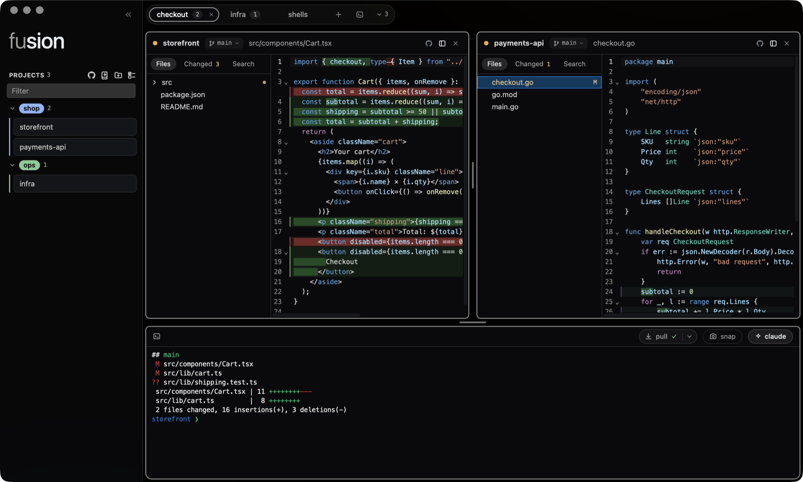
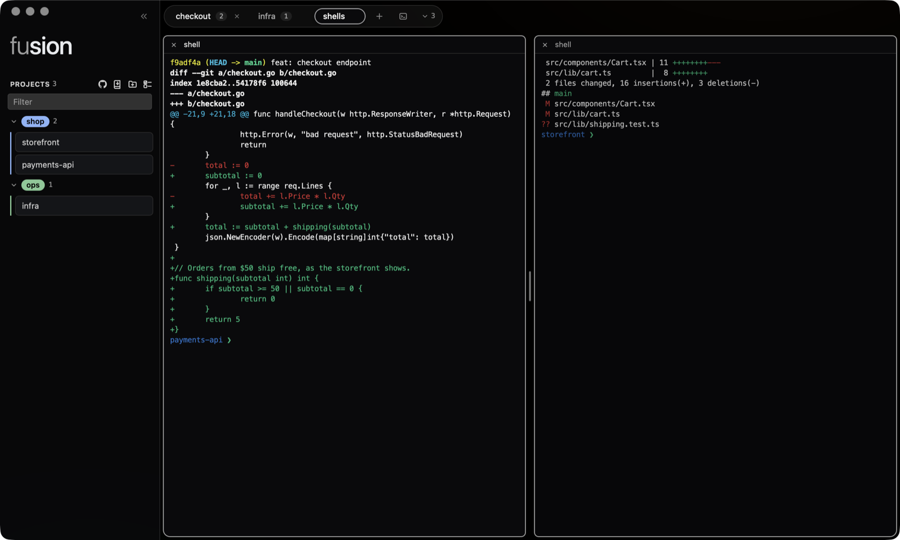

# Fusion

A lightweight macOS IDE where a **tab is a mix of repos**. Drag two or three checkouts into a tab: each gets a code pane, and one terminal sits under them. Run `claude` in that terminal and it can reach exactly those repos — remove a project from the tab and the session loses access to it.

Built with Tauri 2 (Rust + the system WebKit), React, CodeMirror 6 and xterm.js. The app is about 6 MB.



## Install

Fusion runs on Apple Silicon Macs with macOS 13 or later.

### From the release (no build tools)

```sh
gh release download v0.2.4 -R yevgeniyo-ps/fusion -p '*.dmg'
open Fusion_0.2.4_aarch64.dmg
```

Drag **Fusion** to **Applications**, then open it from Launchpad or Spotlight.

The app is signed ad hoc, not with an Apple Developer ID, so Gatekeeper checks where it came from:

- Downloaded with `gh` (above): it opens normally.
- Downloaded in a browser: macOS marks it as quarantined and refuses to open it. Clear the mark once:

  ```sh
  xattr -dr com.apple.quarantine /Applications/Fusion.app
  ```

  Or open it once, then choose **System Settings → Privacy & Security → Open Anyway**.

To use the Claude features, install the [`claude` CLI](https://docs.claude.com/en/docs/claude-code) so that it is on your shell's PATH.

To update, quit Fusion and install the new DMG the same way. Your projects, tabs and terminals are kept (they live outside the app, see [Where data lives](#where-data-lives)).

### From source

Requirements: Node 24+, Rust (`brew install rustup && rustup default stable`), Xcode Command Line Tools.

```sh
git clone https://github.com/yevgeniyo-ps/fusion.git && cd fusion
npm ci
npm run tauri build
cp -R src-tauri/target/release/bundle/macos/Fusion.app /Applications/
```

The build also writes the DMG to `src-tauri/target/release/bundle/dmg/`. The app icon is compiled from `src-tauri/icons/AppIcon.icon` (an Icon Composer file) by `scripts/app-icon.sh`, which needs Xcode 26; the compiled `Assets.car` is checked in, so you only run it after changing the icon.

## Develop

```sh
npm run tauri dev
```

Rust tests: `cd src-tauri && cargo test`. Type check: `npx tsc -b`.

Dev and release builds share the same data folder, so quit one before starting the other.

## Using it

**Projects** — the sidebar lists your checkouts. Add one with **Clone Repository** (⌘⇧C) or **Add Folder** (⌘O), or **Import from GitHub** (the GitHub icon): give it an org, tick the repos, and Fusion checks them out into a folder and adds them — a repo already checked out there is only added. Click projects to pick them and **Open in new tab**, or use the select mode to **Group** or **Remove** many at once (a removed project's folder stays). Group projects as Chrome groups tabs: name, colour, drag to reorder, sort A–Z.

**Tabs** — drag projects onto a tab, onto the open tab's panes, or onto **+** for a new mix. Drag a tab to reorder it; double-click to rename it. Many tabs scroll in the strip; **▾** (⌘⇧A) lists them all. **⌘K** (or ⌘⌥P) jumps to any tab by name or project, and Enter on an empty search goes back to the previous tab. Each tab keeps its own terminal height.

**Terminal tabs** — ⌘⇧T opens a tab of plain shells. Split like iTerm: ⌘D right, ⌘⇧D down, ⌘] / ⌘[ to move between panes, ⌘⇧↩ to zoom one.



**Zoom a block** — double-click any pane, terminal or split to fill the tab with it; double-click again to bring the layout back.

**Code panes** — file tree with git colours, editor with an inline diff against HEAD (green/red, ⌥F5 for the next change, *revert* per chunk). Files reload when they change on disk, so you watch Claude's edits as they happen, and save themselves a second after you type. **Search** (⌘⇧F) finds text in the whole project, with match case, whole word and regular expressions; `.gitignore` is honoured. The branch chip switches branches, checks out remote ones, and creates a branch (and pushes it). The GitHub button opens the file at the cursor's line (⌥-click copies the link); right-click a line for **Open on GitHub**. Drag the line between panes to resize them.

**Terminal header** — **pull** runs `git pull` in the tab's projects (it lights up blue with a ↓ count when the remote has new commits; Fusion fetches quietly every 3 minutes). When claude or another program is in the terminal, the pull runs in the background instead (fast-forward only) and lists the result per project. **snap** (⌘⇧2) captures a screen area to the clipboard and pastes its path into the terminal. **claude** starts the tab's session. While claude runs, the header counts its tokens and what they would cost at Claude API list prices.

**Restore** — on restart, every terminal comes back in its folder and runs what it was running (`watch …`, `claude`, a pipeline), and each pane opens its file again. A `sudo` command is typed but not run.

| Keys | |
|---|---|
| ⌘T / ⌘⇧T | New project tab / terminal tab |
| ⌘1 … ⌘9 | Go to tab |
| ⌘K / ⌘⌥P | Jump to a tab or a project |
| ⌘⇧A | List all tabs |
| ⌘⇧C / ⌘O | Clone a repo / add a folder |
| ⌘⇧F | Search the project of the focused pane |
| ⌘+ / ⌘- / ⌘0 | Font size of the focused terminal or editor |
| ⌘S | Save |
| ⌘⇧2 | Screenshot an area into the terminal |
| [ | Show or hide the projects |

## How the Claude scoping works

Each project tab has a folder in `~/Library/Application Support/dev.fusion.ide/tabs/<id>/` with a generated `CLAUDE.md` and a symlink per project. The tab's shell puts a small wrapper (`src-tauri/resources/claude.sh`) first on PATH, so `claude` runs with that folder as its working directory and one `--add-dir` per project, under a session id that belongs to the tab. When you add or remove a project, Fusion stops claude and the wrapper starts it again with `--resume` and the new directories: the conversation stays, the access follows the tab. Subcommands (`claude mcp …`, `claude update`) go to the real claude untouched.

## Where data lives

`~/Library/Application Support/dev.fusion.ide/`: `projects.json` (your project list), `layout.json` (tabs, splits, what each terminal runs) and `tabs/` (the tab folders above). Per-pane font sizes are kept in the web view's local storage.

## Limits

- macOS only.
- Screenshots need Screen Recording permission for Fusion (System Settings → Privacy & Security).
- The background fetch never asks for a password; a repo that needs one keeps its last known ↓ count.
- No LSP or push of local commits yet (a new branch can be pushed from the branch menu).
- The token cost is an estimate at list prices (`src-tauri/src/usage.rs`), not a bill.
- Import from GitHub needs the GitHub CLI (`gh`), signed in; github.com only.

## Contributing

Bug reports, ideas and pull requests are welcome. See [CONTRIBUTING.md](CONTRIBUTING.md) for how to build, test and send a change, and [SECURITY.md](SECURITY.md) to report a vulnerability privately. Everyone taking part follows the [Code of Conduct](CODE_OF_CONDUCT.md).

## License

[MIT](LICENSE) © 2026 Yevgeniy Ovsyannikov
